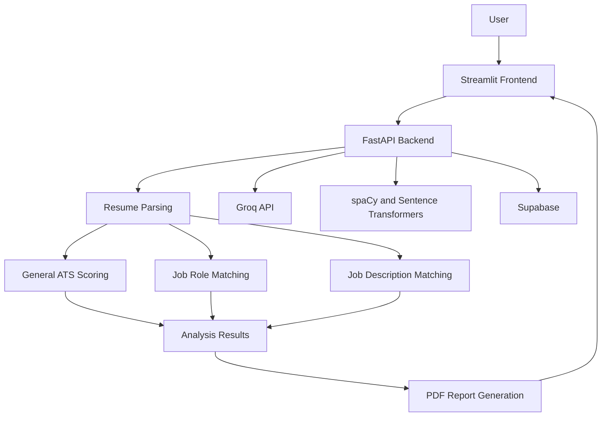

# ResumeATS — AI-Powered Resume Analyzer

**Analyze your resume. Evaluate job readiness. Identify skill gaps.**

ResumeATS is an AI-assisted resume analysis and job matching platform built with Python, Streamlit, FastAPI, NLP technologies, Groq, and Supabase.

It helps users evaluate resume quality, compare their skills against predefined job roles, and identify evidence-based gaps against a specific job description.

## Overview

ResumeATS provides three distinct evaluation capabilities:

1. **General ATS Analysis** — Evaluates resume structure, content quality, keywords, skill evidence, and ATS compatibility using project-defined scoring heuristics.
2. **Job Role Match** — Compares resume skills and project/experience evidence against curated job-role profiles.
3. **Job Description Match** — Evaluates resume skills and supporting evidence against a supplied job description to highlight matches and gaps.

These assessments serve different purposes and should not be interpreted as official ATS rankings or predictions of hiring outcomes.

## Key Features

- Modern Streamlit interface with a responsive SaaS-style design.
- Supabase email/password authentication.
- Optional Google OAuth sign-in.
- PDF, DOC, and DOCX resume upload.
- General ATS score with a detailed component breakdown.
- Matching against eight predefined job-role profiles.
- Custom job-role selection.
- Job description-based skill and evidence matching.
- Matched skills, missing skills, and supporting evidence.
- Experience duration calculation from employment dates.
- Downloadable PDF analysis reports.
- Account-scoped analysis history.
- Analysis history retrieval and deletion.
- Resources section for resume improvement guidance.

## Evaluation Modules

### 1. General ATS Analysis

The General ATS score evaluates five components:

| Component | Maximum Score |
|---|---:|
| Formatting and section structure | 20 |
| Keywords and listed skills | 25 |
| Content quality and measurable outcomes | 25 |
| Skills supported by project/experience text | 15 |
| ATS compatibility heuristics | 15 |
| **Total** | **100** |

The scoring system is project-defined and heuristic-based. It is intended as a resume-quality checklist rather than a universal ATS formula.

Grammar and location checks are not currently configured. Skill validation requires explicit textual evidence in project or experience descriptions rather than relying on semantic similarity alone.

### 2. Job Role Match

ResumeATS includes eight curated job-role profiles:

- Python Developer
- Python Full Stack Developer
- Backend Developer
- Data Analyst
- Data Scientist
- Machine Learning Engineer
- SQL Developer
- DevOps Engineer

The role-match score uses the following weighting:

| Evaluation | Weight |
|---|---:|
| Required-skill coverage | 70% |
| Explicit skill evidence in projects/experience | 20% |
| Preferred-skill coverage | 10% |

The report presents role requirements, matched skills, missing skills, and detected evidence.

A custom role title can be entered, but a numeric score is intentionally not generated unless a curated skill profile is available. The application does not invent job requirements from a short job title.

### 3. Job Description Match

Users can provide a job description to evaluate how their resume aligns with the specified opportunity.

The evaluation helps identify:

- Skills mentioned in the job description.
- Skills found in the resume.
- Skills supported by project or experience descriptions.
- Missing requirements and evidence gaps.

A detected skill mention does not automatically establish practical proficiency. Users should verify the evidence before representing a skill on their resume.

## Technology Stack

| Technology | Purpose |
|---|---|
| Python | Core application development |
| Streamlit | Frontend and user interface |
| FastAPI | Backend API |
| spaCy | Natural language processing |
| Sentence Transformers | Semantic text representation |
| Groq API | AI-assisted resume information processing |
| Supabase | Authentication and analysis history |
| SQL | Database operations |
| WeasyPrint | PDF report generation |
| PyTorch | Machine learning model support |

## System Architecture

At a high level, the application follows this workflow:



For detailed component responsibilities, processing flow, and API documentation, see **[System Architecture](docs/architecture.md)**.

## Project Structure

```text
ai-resume-ats/
│
├── backend/
│   ├── api/
│   ├── core/
│   ├── database/
│   ├── models/
│   ├── services/
│   ├── templates/
│   ├── utils/
│   └── main.py
│
├── frontend/
│   ├── assets/
│   ├── components/
│   ├── services/
│   ├── views/
│   └── streamlit_app.py
│
├── jupyter notebooks/
│
├── docs/
│   └── architecture.md
│
├── tests/
│   └── test_jd_evidence_unit.py
│
├── test_jd_evidence.py
├── requirements.txt
├── requirements-dev.txt
├── .gitignore
└── README.md
```

## Getting Started

### Prerequisites

- Python 3.11 or 3.12 recommended.
- Supabase project.
- Groq API key.
- Git.

### 1. Clone the repository

```bash
git clone https://github.com/YOUR_USERNAME/ai-resume-ats.git
cd ai-resume-ats
```

### 2. Create and activate a virtual environment

```bash
python3 -m venv .venv
source .venv/bin/activate
python -m pip install --upgrade pip
```

### 3. Install dependencies

```bash
pip install -r requirements.txt
python -m spacy download en_core_web_md
```

If a CPU-only PyTorch installation is required, install the CPU wheel before installing the project requirements:

```bash
pip install torch --index-url https://download.pytorch.org/whl/cpu
pip install -r requirements.txt
```

### 4. Configure environment variables

Create a `.env` file in the project root using `env.example` as a reference.

```env
SUPABASE_URL=https://YOUR_PROJECT.supabase.co
SUPABASE_ANON_KEY=YOUR_SUPABASE_ANON_KEY
SUPABASE_KEY=YOUR_SERVER_SIDE_SUPABASE_KEY
SUPABASE_JWT_SECRET=YOUR_JWT_SECRET
GROQ_API_KEY=YOUR_GROQ_API_KEY
AUTH_REDIRECT_URL=http://localhost:8501
```

**Security:** Never commit `.env` or expose server-side Supabase credentials, JWT secrets, or Groq API keys in frontend code, browser JavaScript, screenshots, or public repositories.

### 5. Configure Supabase

Configure the following in Supabase:

- Authentication Site URL.
- Allowed redirect URLs.
- Email/password authentication.
- Google OAuth credentials and callback URLs, if Google sign-in is enabled.
- A working SMTP provider for email confirmation, where required.

For local development, use `http://localhost:8501` as the frontend URL. For deployment, configure the actual deployed frontend URL in the authentication settings and `AUTH_REDIRECT_URL`.

### 6. Configure the database

The backend expects an `analyses` table containing at least:

| Column | Type |
|---|---|
| id | UUID primary key |
| user_id | UUID |
| filename | text |
| ats_score | numeric |
| keyword_match | numeric |
| missing_keywords | jsonb |
| created_at | timestamptz |
| analysis_result | jsonb |

Apply appropriate Row Level Security (RLS) policies so users can access only their own analysis records. Keep server-side credentials private and validate the authenticated user before database operations.

### 7. Start the backend

From the project root:

```bash
uvicorn backend.main:app --reload --host 127.0.0.1 --port 8000
```

The backend initializes the NLP and embedding models during startup. Initial model loading may take additional time.

### 8. Start the frontend

Open a second terminal, activate the virtual environment, and run:

```bash
streamlit run frontend/streamlit_app.py
```

Open the application at:

```text
http://localhost:8501
```

## API Reference

The backend exposes the following endpoints under `/api/v1`:

| Method | Endpoint | Description |
|---|---|---|
| POST | `/api/v1/analyze-resume` | Analyze an uploaded resume |
| GET | `/api/v1/health` | Check backend health |
| GET | `/api/v1/history` | Retrieve analysis history |
| DELETE | `/api/v1/history/{analysis_id}` | Delete an analysis |
| POST | `/api/v1/generate-pdf` | Generate an analysis PDF |
| GET | `/api/v1/history/{analysis_id}/pdf` | Retrieve a historical PDF report |

## PDF Export Dependencies

On Ubuntu/WSL, install the required system packages for WeasyPrint if they are not already available:

```bash
sudo apt update
sudo apt install -y libcairo2 libpango-1.0-0 libpangoft2-1.0-0 libffi-dev
```

## Limitations and Responsible Use

- ResumeATS is a resume review assistant, not an employer ATS simulator.
- Curated role profiles represent general skill expectations and may not reflect every employer's requirements.
- Custom role titles do not receive a numeric role score without a curated profile.
- Resume extraction and structured parsing may produce errors; always verify the extracted information.
- Grammar and location checks are not configured in the current scoring pipeline.
- Scores are guidance signals and do not guarantee ATS acceptance, interview selection, or employment.
- Do not add skills or experience to a resume unless they accurately represent your abilities.

## Future Improvements

Potential areas for further development include:

- Additional curated job-role profiles.
- Expanded resume parsing and validation.
- More comprehensive automated testing.
- Further deployment and monitoring improvements.

---

**ResumeATS** — A practical application of Python, backend development, NLP, and AI-assisted resume analysis.
