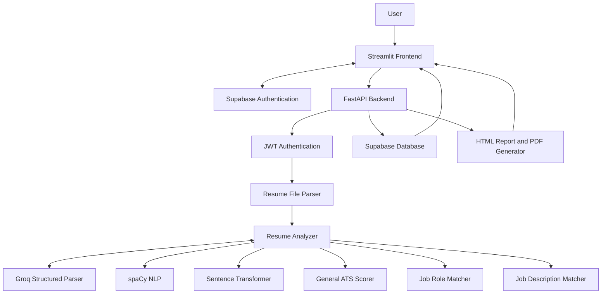
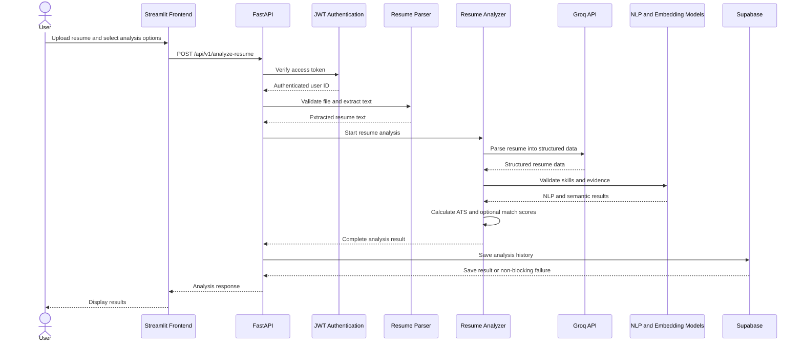

# ResumeATS — System Architecture

## 1. Overview

ResumeATS is an AI-assisted resume analysis application built with Python.
It evaluates uploaded resumes through a general ATS assessment pipeline and
optional job-role and job-description matching workflows.

The application uses a Streamlit frontend and a FastAPI backend. Its analysis
pipeline combines document text extraction, Groq-powered structured parsing,
natural language processing, semantic similarity, rule-based scoring, and
evidence-based skill matching.

Supabase provides authentication and persistent analysis history, while
WeasyPrint generates downloadable PDF reports.

### Core capabilities

- General ATS scoring with five assessment components.
- Skill validation against project and employment evidence.
- Matching against predefined job-role profiles.
- Matching against an employer-provided job description.
- Employment experience calculation.
- Detailed feedback and improvement recommendations.
- Authenticated analysis history.
- PDF report generation.

## 2. Technology and Components

| Component | Technology | Responsibility |
|---|---|---|
| Frontend | Streamlit | User interface and user interaction |
| Backend API | FastAPI | HTTP endpoints and request handling |
| Document extraction | Python PDF, DOC and DOCX libraries | Extract text from uploaded resumes |
| Structured parsing | Groq API | Convert resume and job-description text into structured data |
| NLP | spaCy | Natural language processing |
| Semantic matching | Sentence Transformers | Semantic skill and evidence matching |
| Database | Supabase | Persist analysis history |
| Authentication | Supabase Auth and JWT | User authentication and backend token verification |
| PDF reporting | WeasyPrint | Convert generated HTML reports into PDF |
| Data validation | Pydantic | Validate API request and response data |

## 3. Backend Structure

```text
backend/
├── api/
│   ├── auth.py
│   └── routes.py
├── core/
│   └── config.py
├── database/
│   └── supabase_db.py
├── models/
│   └── schemas.py
├── services/
│   ├── ats_scorer.py
│   ├── feedback_engine.py
│   ├── groq_parser.py
│   ├── job_description_matcher.py
│   ├── pdf_export.py
│   ├── report_generator.py
│   ├── resume_analyzer.py
│   ├── resume_parser.py
│   ├── role_matcher.py
│   └── role_profiles.py
├── utils/
│   ├── experience_utils.py
│   ├── file_utils.py
│   └── matching.py
└── main.py
```

### Important module responsibilities

| Module | Responsibility |
|---|---|
| `main.py` | FastAPI application initialization, middleware and model startup |
| `api/routes.py` | Analysis, health, history and PDF API endpoints |
| `api/auth.py` | JWT verification and authenticated user extraction |
| `core/config.py` | Application configuration |
| `models/schemas.py` | Pydantic request and response schemas |
| `database/supabase_db.py` | Supabase analysis history operations |
| `services/resume_parser.py` | File validation and document text extraction |
| `services/groq_parser.py` | Structured resume and job-description parsing |
| `services/resume_analyzer.py` | Coordinates the complete resume analysis pipeline |
| `services/ats_scorer.py` | General ATS scoring and score interpretation |
| `services/role_matcher.py` | Matching against predefined job roles |
| `services/role_profiles.py` | Curated job-role profiles |
| `services/job_description_matcher.py` | Job-description-specific matching |
| `services/feedback_engine.py` | Analysis issue summaries |
| `services/report_generator.py` | HTML report generation |
| `services/pdf_export.py` | Combined PDF generation |
| `utils/experience_utils.py` | Employment experience calculation |
| `utils/matching.py` | Skill normalization and matching utilities |
| `utils/file_utils.py` | Logging, fallback and utility functions |

## 4. High-Level System Architecture

The application follows a frontend-backend architecture. Streamlit handles
user interaction, FastAPI manages API requests, and backend services perform
resume processing and analysis.



## 5. Application Startup and Model Loading

The FastAPI application initializes shared resources during its startup
lifespan.

### Startup process

1. FastAPI starts its application lifespan.
2. The configured spaCy language model is loaded.
3. If the primary spaCy model cannot be loaded, the configured fallback
   model is attempted.
4. The Sentence Transformer embedding model is initialized.
5. Both model instances are stored in `app.state`.
6. API requests access these shared instances during analysis.

This approach avoids loading the NLP and embedding models separately for
every resume request.

The health endpoint exposes whether the NLP and embedding models are loaded.

## 6. Resume Analysis Request Lifecycle

The following sequence describes the main resume analysis workflow.



### Detailed processing steps

1. The user uploads a supported resume file through Streamlit.
2. The frontend sends the file and optional role or job description to
   the analysis API.
3. The backend verifies the user's access token.
4. The resume parser validates the file and extracts its text.
5. The resume analyzer sends the extracted text for structured parsing.
6. Parsed skills, projects, experience and other resume information are
   prepared for analysis.
7. Skill validation checks whether listed skills have supporting evidence.
8. The general ATS scoring pipeline calculates the overall score.
9. Optional job-role and job-description matching workflows run when
   their corresponding inputs are provided.
10. Feedback, critical issues and improvement suggestions are generated.
11. The result is returned and an attempt is made to save it to Supabase.

Analysis history persistence is non-blocking: a history-save failure is
logged without automatically discarding an otherwise successful analysis
response.

## 7. Resume Extraction and Structured Parsing

### File extraction

The resume parser is responsible for validating uploaded documents and
extracting readable text.

Supported document formats include:

- PDF
- DOCX
- DOC

The parser contains format-specific extraction functions and handles file
validation and extraction errors.

### Structured parsing

After text extraction, the Groq integration processes the resume and
converts its contents into structured information.

The parsed information can include:

- Contact information
- Education
- Employment history
- Technical skills
- Projects
- Resume keywords
- Action verbs

The structured result is validated before being passed to the analysis
pipeline.

Job descriptions can also be parsed into structured information for the
job-description matching workflow.

## 8. General ATS Scoring

The general ATS scorer evaluates the resume through five assessment
components.

| Component | Maximum Weight |
|---|---:|
| Formatting | 20 |
| Keywords | 25 |
| Content | 25 |
| Skill Validation | 15 |
| ATS Compatibility | 15 |
| **Total** | **100** |

### Scoring components

**Formatting — 20 points**

Evaluates resume formatting characteristics and structural readability.

**Keywords — 25 points**

Evaluates relevant keyword coverage in the resume.

**Content — 25 points**

Evaluates the quality and relevance of resume content.

**Skill Validation — 15 points**

Checks whether listed skills have supporting evidence in projects and
employment information. Semantic similarity can assist this process.

**ATS Compatibility — 15 points**

Evaluates ATS-related compatibility characteristics.

The component scores contribute to the final general ATS score, which is
returned with strengths, issues and improvement suggestions.

### Important implementation note

Grammar and location results currently use default fallback results in
the analysis pipeline. They should not be described as fully implemented
automated grammar or location verification checks.

The ATS score is an application-generated assessment, not a guarantee of
selection or compatibility with every employer's ATS.

## 9. Job Role Matching

Job Role Match evaluates a resume against a predefined job-role profile.

The application includes curated role profiles such as:

- Python Developer
- Python Full Stack Developer
- Backend Developer
- Data Analyst
- Data Scientist
- ML Engineer
- SQL Developer
- DevOps Engineer

A custom role can also be entered. However, a custom role without a
corresponding curated profile does not receive a fabricated numeric
matching score.

### Role matching approach

The implemented matching formula uses three weighted components:

| Component | Weight |
|---|---:|
| Required skill matching | 70% |
| Project and employment evidence | 20% |
| Preferred skill matching | 10% |

The matcher considers normalized skills and supporting evidence from
resume projects and employment information.

The result helps identify matching skills and gaps against the selected
role profile.

## 10. Job Description Matching

Job Description Match evaluates the resume against the actual job
description provided by the user.

Unlike predefined role matching, this workflow uses the supplied job
description as its input.

### Processing workflow

1. The supplied job description is validated.
2. Groq parses it into structured job requirements.
3. Relevant skills and responsibilities are extracted.
4. Resume skills and project or employment evidence are evaluated.
5. Matching logic checks skill presence and practical evidence.
6. Responsibility-related evidence is considered.
7. The application calculates the job-description match result and
   identifies missing or insufficiently supported requirements.

### Matching considerations

The matcher uses skill normalization, text matching and evidence checks.
It distinguishes between a skill being mentioned in a resume and having
supporting practical evidence.

The result is intended to help users understand how their resume aligns
with a particular job description. It does not guarantee recruiter
shortlisting.

## 11. Employment Experience Calculation

The experience utility processes employment date information and
calculates the duration of work experience.

The calculation uses date parsing and month-based duration logic.

The resulting experience information is used by the analysis pipeline
and can contribute to job-role and job-description matching.

Experience calculations depend on the dates and employment information
provided in the parsed resume.

## 12. Feedback and Recommendations

After scoring and matching, the analysis pipeline generates feedback
to explain the results.

The feedback system can provide:

- Resume strengths
- Critical issues
- Improvement suggestions
- Issue summaries
- Score interpretation
- Skill validation details
- Missing or weakly supported requirements

The feedback engine organizes analysis issues, while the ATS scorer and
resume analyzer contribute scoring-related feedback and recommendations.

These recommendations are intended as guidance for improving resume
quality, not as a hiring decision.

## 13. Authentication and Authorization

Supabase Auth provides the frontend authentication experience, including
email/password authentication and Google OAuth.

The FastAPI backend protects authenticated endpoints using JWT bearer
tokens.

### Backend token verification

The authentication dependency:

1. Reads the bearer token from the request.
2. Verifies the token signature.
3. Supports ES256 and RS256 verification through Supabase JWKS.
4. Supports HS256 verification using the configured Supabase JWT secret.
5. Checks that the token audience is `authenticated`.
6. Extracts the authenticated user's ID from the token subject (`sub`).

Missing, expired or invalid tokens result in an HTTP 401 response.

The health endpoint is publicly accessible. Analysis, history and PDF
endpoints that require a user identity use the authentication dependency.

## 14. Supabase Analysis History

Supabase stores completed analysis records for authenticated users.

The database integration communicates with Supabase through its REST API
using HTTP requests.

### Stored information

An analysis record includes:

- Analysis ID
- User ID
- Uploaded filename
- ATS score
- Keyword match information
- Missing keywords
- Creation timestamp
- Full analysis result

### Database operations

| Operation | Function | Purpose |
|---|---|---|
| Save | `save_analysis()` | Persist an analysis result |
| Read | `get_user_history()` | Retrieve a user's analysis history |
| Delete | `delete_analysis()` | Delete an analysis belonging to a user |

History retrieval filters records using the authenticated user's ID.
Deletion also filters by both analysis ID and user ID.

The application therefore applies user-specific filtering in its database
operations. Database-level Row Level Security (RLS) is a separate
Supabase configuration and should be verified independently.

## 15. PDF Report Generation

The application supports downloadable PDF reports.

### PDF generation workflow

1. The frontend requests PDF generation using analysis data.
2. The backend validates the request using its response schema.
3. Report generation functions prepare HTML report content.
4. The PDF export service combines the HTML documents.
5. WeasyPrint converts the HTML into a PDF document.
6. FastAPI returns the generated file as an `application/pdf` response.

The application also supports generating a PDF report from a saved
analysis in the authenticated user's history.

## 16. API Reference

The FastAPI router uses the `/api/v1` prefix.

| Method | Endpoint | Authentication | Purpose |
|---|---|---|---|
| GET | `/api/v1/health` | No | Check API and model status |
| POST | `/api/v1/analyze-resume` | Yes | Analyze an uploaded resume |
| GET | `/api/v1/history` | Yes | Retrieve analysis history |
| DELETE | `/api/v1/history/{analysis_id}` | Yes | Delete a history record |
| POST | `/api/v1/generate-pdf` | Yes | Generate a PDF from analysis data |
| GET | `/api/v1/history/{analysis_id}/pdf` | Yes | Generate a PDF from a saved analysis |

### Health response

The health endpoint reports:

- Application status
- Whether the spaCy model is loaded
- Whether the embedding model is loaded

### Analysis request

The analysis endpoint accepts:

- Resume file
- Optional job role
- Optional job description

The response contains the analysis result, including applicable scores,
matching details and feedback.

### API documentation

FastAPI provides interactive API documentation at:

- `/docs` — Swagger UI
- `/redoc` — ReDoc

These routes are available when the backend is running.

## 17. Error Handling and Limitations

### Error handling

The backend handles common request and processing failures.

| Situation | Expected handling |
|---|---|
| Missing or invalid authentication token | HTTP 401 |
| Invalid or unsupported resume file | HTTP 422 |
| Resume analysis processing failure | HTTP 500 |
| History record not found or not owned by user | HTTP 404 |
| History save failure | Logged warning; analysis response remains non-blocking |

The application also includes utility functions for logging and fallback
results.

### Current limitations

- ATS scores are estimates and cannot reproduce every employer's ATS.
- Resume parsing quality depends on document structure and text extraction.
- AI-generated structured parsing may require manual verification.
- Semantic similarity is not equivalent to human evaluation.
- Grammar and location analysis currently use default fallback results.
- Custom job roles without curated profiles do not receive a numeric role
  match score.
- Job-description matching depends on the quality of the supplied
  description and extracted resume information.
- Database-level security policies must be configured and verified
  separately in Supabase.

## 18. Development Setup

### Prerequisites

- Python 3.11 or 3.12 recommended
- Git
- Supabase project
- Groq API key
- WeasyPrint system dependencies

### Environment configuration

Create a local `.env` file using `env.example` as a reference.

Configure the required application credentials:

```env
SUPABASE_URL=
SUPABASE_ANON_KEY=
SUPABASE_KEY=
SUPABASE_JWT_SECRET=
GROQ_API_KEY=
AUTH_REDIRECT_URL=
```

Do not commit `.env`, access tokens, API keys or service-role credentials
to version control.

### Install dependencies

```bash
python -m venv .venv
source .venv/bin/activate
pip install -r requirements.txt
```

Install the spaCy model required by the project:

```bash
python -m spacy download en_core_web_md
```

Install the WeasyPrint system dependencies required by your operating
system before testing PDF generation.

### Run the backend

From the project root:

```bash
uvicorn backend.main:app --host 127.0.0.1 --port 8000
```

### Run the frontend

In a separate terminal, activate the project environment and run:

```bash
streamlit run frontend/streamlit_app.py
```

The frontend and backend must both be running for the complete local
application workflow.

---

## 19. Architecture Summary

ResumeATS separates user interaction, API handling, analysis services,
authentication, persistence and report generation into dedicated
application components.

The Streamlit frontend communicates with the FastAPI backend. The backend
coordinates document extraction, structured parsing, NLP processing,
ATS scoring and optional matching workflows. Supabase manages
authentication and analysis history, while WeasyPrint handles PDF
generation.

This modular structure makes the application easier to understand,
maintain, test and extend.
